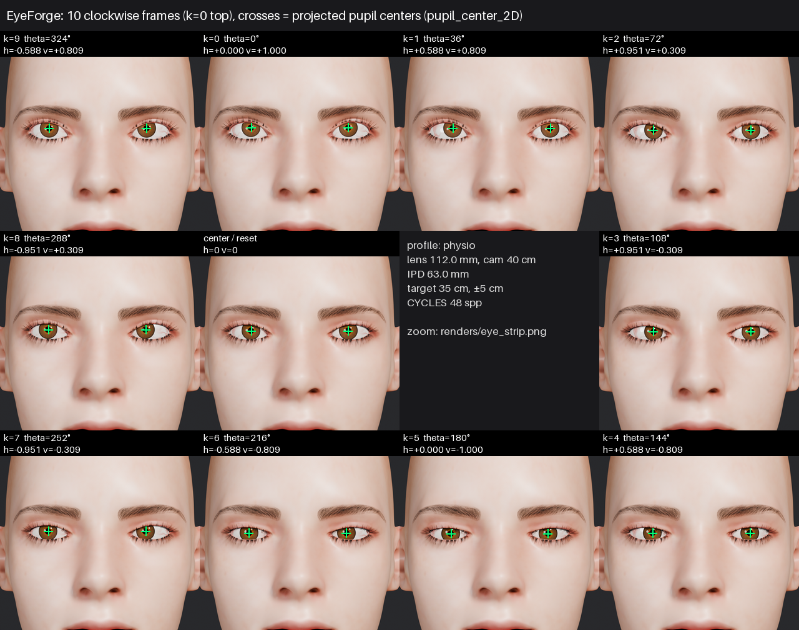
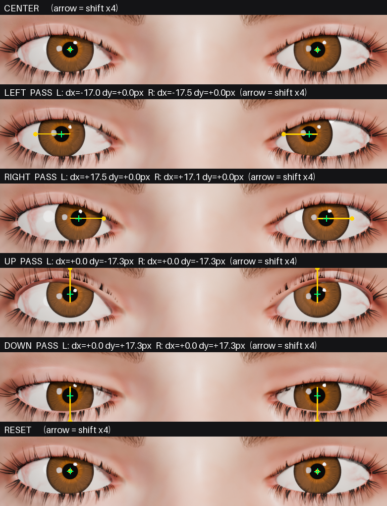
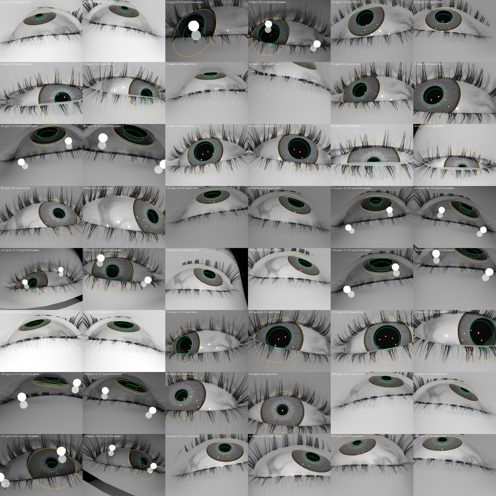
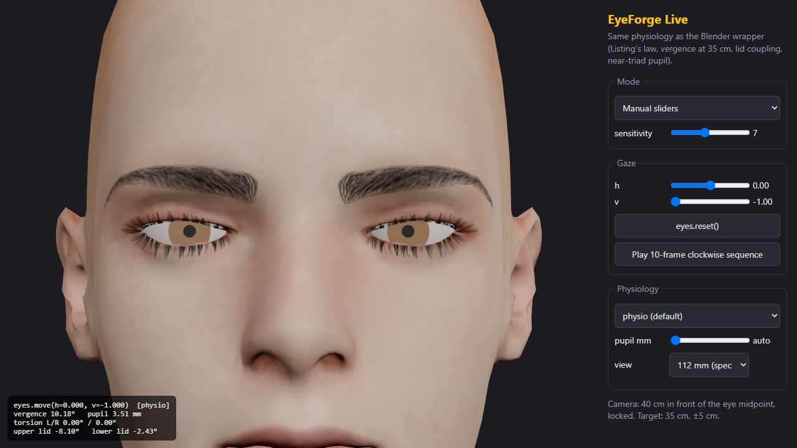

# EyeForge

[](https://github.com/DhruvGoyal404/eyeforge/actions/workflows/ci.yml)

**Samsung PRISM XR Hackathon 2026, Track 1: Synthetic Eye Movement & Virtual Camera Rendering**
Team **Orchestrators** (Thapar Institute of Engineering and Technology): Vaani Prashar, Dhruv Goyal.

> Others move pupils. EyeForge simulates eyes: true 3D eyeball rotation that follows Listing's
> law, real binocular vergence at 35 cm, eyelids that follow gaze, refraction-aware pupil labels
> verified against the actual render, and an XR-style near-eye pipeline that produces
> tracker-ready training data.

EyeForge is a Blender 4.2 LTS scene (an MPFB2/MakeHuman CC0 human with a rig that has
`eye.L`/`eye.R` bones) plus a Python wrapper. `eyes.move(h, v)` rotates both eyeballs as rigid
bodies about their least-squares-fitted physical centers so that both converge on a fixation
target 35 cm ahead (±5 cm). The lids follow vertical gaze and the pupil constricts for near
vision. `eyes.render()` renders a 1024×1024 PNG from a camera locked 40 cm in front of the eye
midpoint. Every frame is labelled twice: the geometric pupil projection that the spec asks for,
and the pupil as actually seen through the refracting cornea, measured from mask passes of the
real render.



## Quick start

Native (Blender 4.2 LTS + Python 3.11+):
```bash
pip install -r requirements.txt
export BLENDER_PATH=/path/to/blender          # Windows: set BLENDER_PATH=C:\...\blender.exe
./run_all.sh                                   # renders, metadata, tests, report, team zip
```
Docker (no local Blender needed):
```bash
docker build -t eyeforge .
docker run --rm -v "$PWD:/work" eyeforge       # runs ./run_all.sh inside the container
```
Just the required deliverable:
```bash
python wrapper/eyes.py sequence --out renders  # 10 clockwise frames + metadata.json + contact sheet
# or, with Blender directly:
blender -b scene.blend -P wrapper/eyes.py -- sequence --out renders
```

## API (`wrapper/eyes.py`)

Inside Blender with `scene.blend` open (UI Python console or `blender -b scene.blend -P script.py`):
```python
import sys; sys.path.append("/path/to/eyeforge/wrapper")
import eyes
rec = eyes.move(0.5, -0.2)      # clamps to [-1, 1], rotates both eyes, lids, pupil; returns the record
eyes.render("out.png")          # 1024x1024 PNG from the locked camera, returns the path
eyes.reset()                    # h = v = 0: both eyes converge on the centered target
eyes.sequence("renders")        # the 10 clockwise frames + ../metadata.json + contact sheet
eyes.set_profile("spec")        # "spec" | "physio" (default) | "physio_full"
eyes.set_params(pupil_mm=5.0, iris_color=(0.05, 0.12, 0.2), kappa_deg=5.0, l2_gain=0.25)
```
From a normal shell, the same file is a CLI that launches headless Blender for you:
```bash
python wrapper/eyes.py sequence --out renders [--n 10] [--no-masks]
python wrapper/eyes.py pose 1 0 --render right.png --masks right_mask --json right.json
python wrapper/eyes.py --profile spec --samples 16 pose 0 1 --render up_spec.png
```
`move()` never touches the camera, head or lights. A camera that was moved or re-lensed raises an
error. Same inputs give the same rotations and the same pixels (fixed Cycles seed; see the
determinism test).

## Conventions

All of this is also written into `metadata.json → conventions`.

- **Units:** meters for all 3D quantities. Angles in radians in the required keys, with degrees duplicated under `extended`.
- **Frames:** `U` = world up (+Z). `F` = unit forward out of the face, detected from the mesh
  (`F = normalize((C_L − C_R) × U)`, checked against the head centroid; MPFB faces −Y).
  `R_img` = the camera's +X axis in world space, i.e. **image right, which is the subject's left**.
- **Eye labels:** `L`/`R` are the subject's own eyes, so the left eye appears on image right.
- **h, v:** h > 0 moves the pupils toward image right and v > 0 moves them up. Inputs are clamped to [−1, 1].
- **Eye midpoint M:** midpoint of the two eyeball centers.
- **Eyeball center:** least-squares sphere fit to MakeHuman's eyeball helper geometry
  (`helper-l-eye`, `helper-r-eye`, 72 vertices each, max residual 0.21 mm). The eye bone heads
  were 0.084 mm off. The spec requires a fix above 0.2 mm, but EyeForge always snaps the eye and lid bone
  heads exactly onto the fitted centers (logged in `metadata.json → scene.bone_fix`).
- **Fixation target:** `T(h, v) = M + 0.35·F + 0.05·h·R_img + 0.05·v·U` (a 5 cm circle for the sequence).
- **Camera:** at `M + 0.40·F`, looking exactly at `M`, up = `U`. It never moves.
- **Sequence:** `θk = 2πk/10`, `h = sin θk`, `v = cos θk`. k = 0 is straight up, then clockwise in the image.
- **Pixels:** origin at the top-left corner, x right, y down. Pixel (i, j) has its center at (j + 0.5, i + 0.5).
- **camera_matrix:** 3×4 `P = K[R|t]` in the OpenCV convention (camera +Z forward, +Y down).
  `K`, `R` and `t` are also under `extended`. Blender's −Z-forward/+Y-up camera is converted with `diag(1, −1, −1)`.
- **eye_rotation_L/R:** world-frame Euler angles in Blender `XYZ` order (`R = Rz·Ry·Rx`), in radians,
  of the eyeball rotation relative to rest (optical axis along `F`). The quaternion (w, x, y, z) and the gaze vector are under `extended`.
- **pupil_center_2D_L/R:** the geometric projection of the 3D pupil-disk center through `P`
  (no refraction). This is the spec's "projected at 40 cm". The refraction-aware apparent centroid is in `extended`.

## Calibration and the lens choice

At 35 cm, ±5 cm is only ±8.1° of gaze. If the camera shows the whole head, the pupil moves just
a few pixels. The spec fixes the camera *position* but not the lens, so `tools/build_scene.py`
picks the focal length analytically (sensor width 36 mm). Pixel offsets from the principal point
scale linearly with f, so with normalized image coordinates `n = (x/z, y/z)`:

- framing: `f_px · max|n_ROI| ≤ W/2 − 0.06·W`, where the ROI is every vertex of both eyebrows and
  eyelashes (so eyes, brows and nose bridge are inside a 6 % margin), and
- motion: `f_px · min|Δn| ≥ 15 px` over both eyes for L, R, U and D versus center.

The longest lens that meets the framing bound maximizes visible motion. It is rounded down to
0.5 mm: **112 mm** (framing allows ≤ 112.0 mm; 15 px needs ≥ 102.7 mm; predicted minimum
shift 16.4 px). The measured shifts are in the results table below.

The pupil centers are labelled twice:

| key | what it is |
|---|---|
| `pupil_center_2D_L/R` | geometric projection of the 3D pupil center through `P` (required key) |
| `extended.pupil_center_2D_geometric_mask_L/R` | centroid of an emission mask pass with the cornea hidden; should equal the projection |
| `extended.pupil_center_2D_apparent_L/R` | centroid of the same mask pass seen *through* the glass cornea (IOR 1.376): where the pupil really appears |
| `extended.reprojection_error_px` | projection vs geometric mask, per eye |
| `extended.refraction_shift_px` | apparent vs geometric, per eye |

Mask passes are cheap 16-sample emission-only renders. The left pupil emits red, the right pupil
green, everything else is black, and the cornea becomes a pure refraction BSDF. They live in
`renders/extra/masks/` and never mix with the required frames.

## Physiology (`wrapper/physiology.py`, pure numpy, unit-tested)

| feature | model | spec | physio (default) | physio_full |
|---|---|:-:|:-:|:-:|
| per-eye vergence | each eye aims at `T`: `g = normalize(T − C_eye)`; at center each turns in by `atan(IPD/2 / 0.35)` = 5.14° | ✓ | ✓ | ✓ |
| rotation | spec: look-at (Fick gimbal: yaw about U, then pitch) → false torsion `tan(ψ/2) = tan(az/2)·tan(el/2)`. physio: **Listing's law**, a single rotation with axis `p × g` and angle `acos(p·g)` (quaternion built directly, no Euler composition), so torsion is exactly 0 | look-at | Listing | Listing |
| L2 (binocular Listing) | primary direction rotated temporally by `l2_gain · vergence` (default gain 0.25), then Listing from it | | | ✓ |
| angle kappa | visual axis (aims at T) offset 5° nasally from the optical axis | | | ✓ |
| lid–gaze coupling | lid bones `orbicularis03/04` rotate about the eye center's horizontal axis: upper lid 1.0×, lower lid 0.3× the gaze elevation | static | ✓ | ✓ |
| near-triad pupil | `pupil = 4.5 mm − 0.35 mm/D · (1/d)` → 3.5 mm at 35 cm (2.86 D); `pupil_mm` overrides | 4.0 mm fixed | ✓ | ✓ |

The literature reports that Listing's plane rotates temporally with vergence (L2). The gain is a
documented, adjustable approximation. `renders/compare/compare_sheet.png` shows the three profiles
side by side, and `reports/plots/torsion.png` shows torsion spec vs physio.

## Validation results

Generated by `tools/make_report.py` (full report: [`reports/validation.md`](reports/validation.md)).

<!-- VALIDATION:START -->
| Check | Result | Target |
|---|---|---|
| Direction L/R/U/D + reset | PASS (min on-axis shift 17.0 px, reset 0.000 px) | >= 15 px, reset < 0.5 px |
| Reprojection error (projection vs mask) | mean 0.020 px, max 0.040 px | mean < 0.5 px |
| P vs Blender world_to_camera_view | max 0.0009 px | < 0.01 px |
| Vergence at center | 10.286° (analytic 10.286°) | equal |
| Torsion, physio (Listing) vs spec (look-at) | 0.00e+00° vs 0.561° (look-at at 30° oblique: 4.77°) | physio = 0 |
| Refraction shift (apparent vs geometric) | mean 0.71 px | reported |
| Determinism (same frame twice) | mean abs diff 0.0000 / 255 | < 0.05 |
| MediaPipe iris vs our apparent pupil | mean 11.98 px, max 16.56 px on 11/11 images | report only |
| Render time | 139 s/frame (Cycles CPU, 48 spp, i5-1235U) | - |
<!-- VALIDATION:END -->

Tests (`python -m pytest -q tests`):

| test | checks |
|---|---|
| `test_physiology.py` | zero torsion under Listing on a 9×9 grid, Fick torsion formula, vergence 5.14°, unit quaternions, clamping, kappa/L2, Euler round-trip |
| `test_camera.py` | `P` vs Blender `world_to_camera_view` < 0.01 px; camera exactly 0.40 m from M along F, looking at M |
| `test_directions.py` | renders center, L, R, U, D and reset: shift ≥ 15 px with the right sign, off-axis < 30 %, reset < 0.5 px; writes `reports/direction_check.png` |
| `test_sequence.py` | 10 frames 1024² PNG, θ, h and v exact, JSON Schema, clockwise from the top measured on the renders, reprojection error |
| `test_determinism.py` | the same frame rendered twice is identical |
| `test_motion.py` | main sequence, minimum jerk, blinks, microsaccades < 0.5° |
| `test_independent_check.py` | MediaPipe Face Landmarker iris centers vs our labels (report only) |



## Beyond the spec (all optional, never touch the required outputs)

| extra | command | output |
|---|---|---|
| spec vs physio vs physio_full | `make compare` then `python tools/compare.py renders/compare` | `renders/compare/compare_sheet.png` |
| physiological motion (main-sequence saccades, min-jerk, blinks, microsaccades) | `python wrapper/eyes.py animate` or `eyes.animate([(0,0),(1,0),...], fps=30)` | `renders/extra/anim/` + `timeline.json` |
| demo video (H.264) | `python tools/make_video.py` | `docs/demo.mp4` |
| XR near-eye IR dataset factory | `python tools/factory.py --n 200 --seed 0 --out data` (`--shard k/N` for parallel workers, resumable) | `data/images`, `data/masks`, `data/labels.jsonl`, `data/coco.json`, `data/overlay_grid.png` |
| live browser twin | `blender -b scene.blend -P tools/export_gltf.py`, then `npx serve web` | Three.js + MediaPipe webcam gaze, same physiology in JS |

The **dataset factory** places one near-eye camera per eye about 3 cm in front of and below
the eye (headset style), with a ring of 8 IR point LEDs. It renders a grayscale IR look:
bright skin, a mid-grey iris because melanin is nearly transparent in NIR, a black pupil and
sharp corneal glints. It randomizes:
- gaze up to ±30°
- pupil diameter 2–7 mm
- iris color and skin IR reflectance
- LED power and camera pose jitter
- glasses on or off

Each image is labelled with:
- the geometric and refraction-aware pupil ellipses and the limbus ellipse
- glint positions, solved on the corneal sphere (the reflection point whose normal bisects LED
  and camera) and then verified against the rendered image
- class masks (skin, sclera, iris, pupil, lashes/brows) as seen through the cornea
- gaze and optical axes, and the lid aperture

Smoke run (`--n 200 --seed 0`): 200 samples, 400 IR images. 1,942 glints were predicted on
the cornea, and 989 (51 %) were confirmed as bright peaks in the rendered image within 3 px
(mean offset 1.76 px). The rest are hidden by lids or lashes, or are too faint against the iris
to count as a peak. `data/overlay_grid.png` shows the labels drawn on the images: limbus in
yellow, geometric pupil in green, apparent pupil in cyan, glints in red.



The slide deck draft is `docs/Thapar_Orchestrators_EyeForge.pptx` (built by `tools/make_deck.py` from
`reports/validation.json`).

The **web demo** (`web/`) loads the exported glTF. It drives the same eye and lid bones with
`web/physiology.js`, a port of `physiology.py` that `tests/test_web_parity.py` checks matches
Python to 1e-12. Inputs are sliders or your webcam: MediaPipe iris landmarks relative to the eye
corners and lids map to (h, v). It works offline because all libraries are vendored in
`web/vendor`, and it deploys to GitHub Pages via `.github/workflows/pages.yml`.



## Regenerate everything

```bash
./run_all.sh                       # or: make all
make compare                       # spec vs physio vs physio_full sheet (renders/compare/)
make video                         # docs/demo.mp4
python tools/make_bundle.py        # dist/Thapar_Orchestrators.zip in the required layout
```
`scene.blend` itself is rebuilt from MPFB2 and the MakeHuman CC0 assets with
`REBUILD_SCENE=1 MH_ASSETS=/path/to/makehuman/assets ./run_all.sh`
(needs the MPFB2 2.0.18 extension installed in Blender).

Bundle layout (`dist/Thapar_Orchestrators.zip`): `scene.blend`, `wrapper/eyes.py` (+ helper
modules), `renders/frame_00..09.png`, `metadata.json`, `README.md`, plus `contact_sheet.png`,
`eye_strip.png`, `direction_check.png`, `extras/`.

## Assets and licenses

Code: MIT. Head: MPFB2 + MakeHuman system assets (CC0). Eyes and materials: procedural, built by
`tools/build_scene.py`. Details are in [ASSETS.md](ASSETS.md).

## Assumptions

- **"Left/Right" in the direction check** means image left/right (h = −1 / +1), since that is
  what an evaluator sees in the render.
- **The lens is free.** The spec fixes the camera position and orientation only, so the lens is
  auto-calibrated (see above).
- **pupil_center_2D is geometric.** The refraction-aware centroid is provided as an extra.
- **The required 10 frames use the `physio` profile.** It has no kappa, so a centered gaze looks
  centered.

## Limitations

- **Eyeball size follows the asset.** MakeHuman's lids wrap a 15.9 mm-radius socket sphere, while
  a real eyeball is about 12 mm. A 12 mm eye would leave visible gaps at the lid margins, so the
  sclera uses the socket radius (15.65 mm). The visible anatomy is real-sized: iris 11.7 mm, cornea
  radius 7.8 mm, iris 2.84 mm behind the apex. As a result the rotation lever (center to pupil,
  14.3 mm) is about 35 % longer than in a real eye, and pupil travel per degree scales with it.
  Angles, vergence, Listing's law and torsion are independent of that scale.
- **Cornea model.** The cornea and anterior chamber are one refracting solid (n = 1.376). There
  is no separate aqueous humor (n = 1.336) and no crystalline lens.
- **Lids are bone-driven** (MakeHuman's lid bones) rather than sculpted shape keys. Lashes and brows
  are hidden in the mask passes. They never cover the pupil within ±5 cm, but they could at extreme gaze.
- **Render speed.** Cycles on CPU takes about 2 min per frame on a 12-thread laptop (i5-1235U).
  CI uses mask-only renders.
- **MediaPipe** is a sanity check. It needs a padded, downscaled copy of each render to detect the
  face, because the required framing is tight on the eyes. Its iris centers agree with our labels on motion
  direction (mean cosine 0.97). The absolute offset (~12 px) reflects MediaPipe working at half
  resolution on a synthetic face, so it is reported, not asserted.
- **Factory and glasses.** With glasses on, the geometric 2D labels ignore spectacle
  refraction. Use the masks and `pupil_ellipse_apparent`, which are measured from the render.
  MPFB age/ethnicity variation would need a scene rebuild per identity and is not randomized.
- **Docker.** The image was built and run on the development laptop (pinned Blender 4.2.23
  Linux tarball, pinned pip deps). Inside the container, 100 tests pass on the committed scene,
  including the headless direction self-test. A full `run_all.sh` in the container takes as long
  as a native run (~1 h on a 12-thread laptop CPU).
- **Phase 6 (sim-to-real CNN)** is not done. It needs a real-eye dataset slice (MPIIGaze or
  ETH-XGaze) with its license checked.
