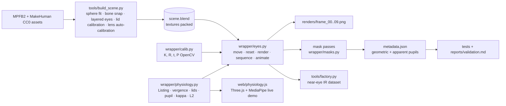

# EyeForge: slide content (official deck template)

Deck file name: `Thapar_Orchestrators_EyeForge.pptx`. Every number below comes from
`reports/validation.json` (regenerate with `python tools/make_report.py`).

---

## 1. Problem

- XR headsets need eye trackers. Trackers need labelled eye images, and real labels are slow,
  noisy and privacy-sensitive.
- Most synthetic-eye toys slide a pupil texture or yaw/pitch a sphere. The rotations are wrong
  (false torsion), the eyes don't converge, the lids don't move, and the labels ignore the
  cornea, so the "ground truth" is off where it matters.
- Track 1 asks for a rig that rotates real 3D eyeballs, a locked camera, a 10-frame clockwise
  sequence and exact 2D/3D labels.

Figure: the naive approach vs ours (crop of `renders/compare/compare_sheet.png`, spec vs physio column).

## 2. Solution

EyeForge simulates eyes, not pupils:
- A textured MPFB2 (CC0) head with `eye.L`/`eye.R` bones snapped onto least-squares-fitted eyeball centers.
- Layered anatomical eyes: sclera with veins and limbal ring, a fibrous iris, a real pupil aperture,
  and a glass cornea (R 7.8 mm, IOR 1.376).
- Physiology engine: Listing's law, per-eye vergence at 35 cm, lid–gaze coupling, near-triad pupil
  (plus kappa and L2 in `physio_full`).
- Two labels per pupil: the geometric projection (spec) and the refraction-aware centroid
  measured from the actual render.

Figure: `docs/eye_closeup.png`, `renders/contact_sheet.png`.

## 3. Architecture



## 4. Track final output

- `Thapar_Orchestrators.zip`: `scene.blend`, `wrapper/eyes.py`, `renders/` (10 frames), `metadata.json`, `README.md`,
  plus the contact sheet, direction check and demo video.
- Camera locked 40 cm from M, lens auto-calibrated to **112.0 mm** so every L/R/U/D move shifts the pupil
  by **≥ 17.0 px** at 1024².
- Direction self-test: **ALL PASS**, reset within **0.000 px**.
- Reprojection error (label vs rendered mask): mean **0.020 px**, max **0.040 px**.
- P vs Blender's own projection: **0.0009 px**. Determinism: **0.0000/255** mean pixel difference.

Figure: `reports/direction_check.png`, `renders/eye_strip.png`.

## 5. Differentiation

| | typical | EyeForge |
|---|---|---|
| rotation | Euler yaw/pitch (false torsion up to **4.8°** at 30° oblique) | Listing's law, torsion **0** |
| binocular | parallel eyes | vergence **10.29°** at 35 cm (analytic 10.29°) |
| lids | static | follow gaze (upper 1:1, lower 0.3:1), blinks |
| pupil | fixed | near-triad **3.5 mm** at 35 cm |
| labels | geometric only | geometric + refraction-aware (cornea shifts the pupil by **0.71 px** mean) |
| validation | eyeballed | 7 automated test files, MediaPipe cross-check, CI |

Figure: `reports/plots/torsion.png`, `renders/compare/compare_sheet.png`.

## 6. Demo and local setup

```bash
git clone https://github.com/DhruvGoyal404/eyeforge && cd eyeforge
pip install -r requirements.txt && export BLENDER_PATH=/path/to/blender
python wrapper/eyes.py sequence --out renders     # or ./run_all.sh, or docker run eyeforge
```
Demo video `docs/demo.mp4` (0 s): API calls → clockwise sequence → direction check → profiles →
saccades/blinks → results. Live: `npx serve web` (webcam gaze drives the avatar).

## 7. Brownie points: realism

- Saccades follow the main sequence (2.2 ms/° + 21 ms) with a minimum-jerk profile; microsaccades < 0.5°; blinks
  close in 100 ms and open in 150 ms.
- XR near-eye dataset factory: IR cameras 3 cm from the eye, 8-LED rings, glints solved on the corneal sphere and
  verified against the render (0% found within 3 px), pupil/limbus ellipses, COCO masks.
- Browser twin: the same physiology in JS (parity with Python to 1e-12), driven by your webcam.

Figures: `data/overlay_grid.png`, `docs/web_demo.png`, frames from `docs/demo.mp4`.
