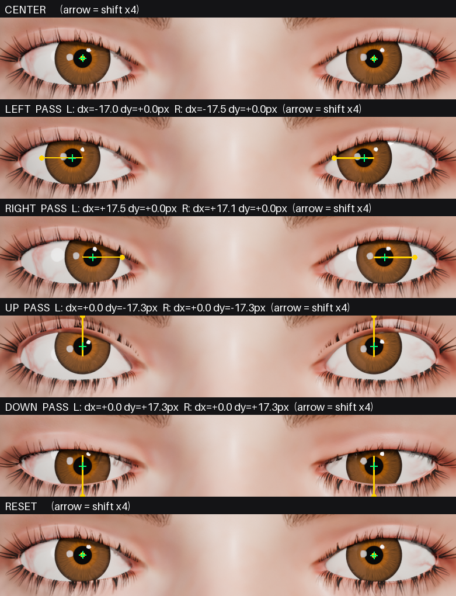
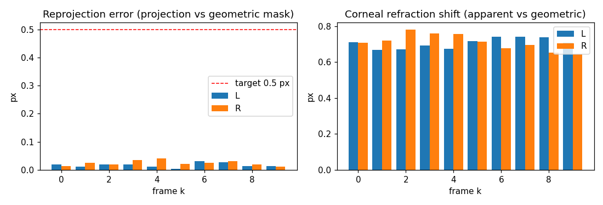
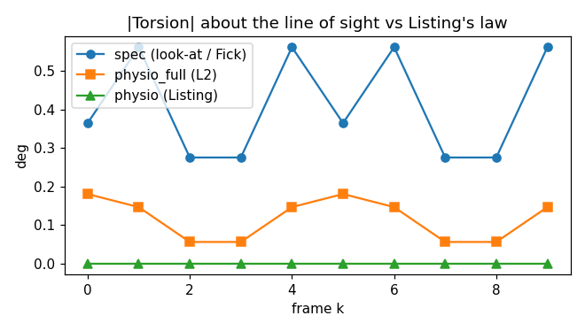
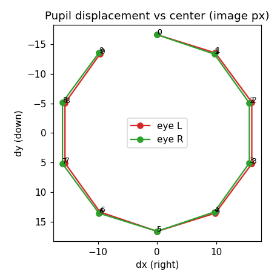

# EyeForge validation report

Generated by `tools/make_report.py` from `metadata.json` and the pytest outputs in `reports/`.

## Summary

| Check | Result | Target |
|---|---|---|
| Direction L/R/U/D + reset | PASS (min on-axis shift 17.0 px, reset 0.000 px) | >= 15 px, reset < 0.5 px |
| Reprojection error (projection vs mask) | mean 0.020 px, max 0.040 px | mean < 0.5 px |
| P vs Blender world_to_camera_view | max 0.0009 px | < 0.01 px |
| Vergence at center | 10.286° (analytic 10.286°) | equal |
| Torsion, physio (Listing) vs spec (look-at) | 0.00e+00° vs 0.561° (look-at at 30° oblique: 4.77°) | physio = 0 |
| Refraction shift (apparent vs geometric) | mean 0.71 px | reported |
| Determinism (same frame twice) | mean abs diff 0.0000 / 255 | < 0.05 |
| MediaPipe iris vs our apparent pupil | mean 11.98 px, max 16.56 px on 11/11 images | report only |
| Render time | 139 s/frame (Cycles CPU, 48 spp, i5-1235U) | - |

## Per-frame (required sequence, profile `physio`)

| k | θ (°) | h | v | reproj L/R (px) | refraction L/R (px) | pupil shift L/R (px) | vergence (°) | torsion physio / spec / full (°) | lid aperture L (mm) | pupil (mm) | render (s) |
|---|---|---|---|---|---|---|---|---|---|---|---|
| 0 | 0 | +0.000 | +1.000 | 0.019 / 0.014 | 0.71 / 0.71 | 16.6 / 16.6 | 10.18 | 0.0e+00 / 0.364 / 0.180 | 13.77 | 3.51 | 130.55 |
| 1 | 36 | +0.588 | +0.809 | 0.011 / 0.026 | 0.67 / 0.72 | 16.7 / 16.5 | 10.15 | 0.0e+00 / 0.561 / 0.146 | 13.49 | 3.51 | 137.72 |
| 2 | 72 | +0.951 | +0.309 | 0.019 / 0.020 | 0.67 / 0.78 | 16.8 / 16.4 | 10.09 | 0.0e+00 / 0.275 / 0.056 | 12.71 | 3.51 | 140.44 |
| 3 | 108 | +0.951 | -0.309 | 0.019 / 0.034 | 0.69 / 0.76 | 16.8 / 16.4 | 10.09 | 0.0e+00 / 0.275 / 0.056 | 11.72 | 3.51 | 147.32 |
| 4 | 144 | +0.588 | -0.809 | 0.011 / 0.040 | 0.67 / 0.76 | 16.7 / 16.5 | 10.15 | 0.0e+00 / 0.561 / 0.146 | 10.92 | 3.51 | 135.22 |
| 5 | 180 | +0.000 | -1.000 | 0.005 / 0.022 | 0.72 / 0.71 | 16.6 / 16.6 | 10.18 | 0.0e+00 / 0.364 / 0.180 | 10.62 | 3.51 | 154.3 |
| 6 | 216 | -0.588 | -0.809 | 0.032 / 0.025 | 0.74 / 0.68 | 16.5 / 16.7 | 10.15 | 0.0e+00 / 0.561 / 0.146 | 10.94 | 3.51 | 238.21 |
| 7 | 252 | -0.951 | -0.309 | 0.026 / 0.030 | 0.74 / 0.70 | 16.4 / 16.8 | 10.09 | 0.0e+00 / 0.275 / 0.056 | 11.73 | 3.51 | 112.78 |
| 8 | 288 | -0.951 | +0.309 | 0.013 / 0.019 | 0.74 / 0.65 | 16.4 / 16.8 | 10.09 | 0.0e+00 / 0.275 / 0.056 | 12.69 | 3.51 | 99.71 |
| 9 | 324 | -0.588 | +0.809 | 0.014 / 0.012 | 0.71 / 0.64 | 16.5 / 16.7 | 10.15 | 0.0e+00 / 0.561 / 0.146 | 13.47 | 3.51 | 97.87 |

## Direction self-test

| direction | eye | dx (px) | dy (px) | off-axis ratio | pass |
|---|---|---|---|---|---|
| left | L | -17.02 | +0.01 | 0.000 | yes |
| left | R | -17.48 | +0.02 | 0.001 | yes |
| right | L | +17.50 | +0.00 | 0.000 | yes |
| right | R | +17.06 | +0.01 | 0.001 | yes |
| up | L | +0.01 | -17.30 | 0.000 | yes |
| up | R | +0.04 | -17.28 | 0.002 | yes |
| down | L | +0.01 | +17.30 | 0.001 | yes |
| down | R | +0.01 | +17.30 | 0.001 | yes |

Reset returns to within 0.0000 px of the first center render.

## Independent check: MediaPipe Face Landmarker

MediaPipe Face Landmarker (float16 v1) run on each render after a 0.5x downscale onto a padded canvas; iris landmarks 468/473 compared with our apparent (refraction-aware) pupil centroids. MediaPipe is trained on real faces and its landmark noise is a few px at this scale, so this is a sanity check, not ground truth.

Iris centers on 11/11 images: mean error 11.98 px, max 16.56 px (vs our apparent pupil centroid).

## Plots

Pipeline time for the sequence (11 renders + 22 mask passes): 1590.9 s.
